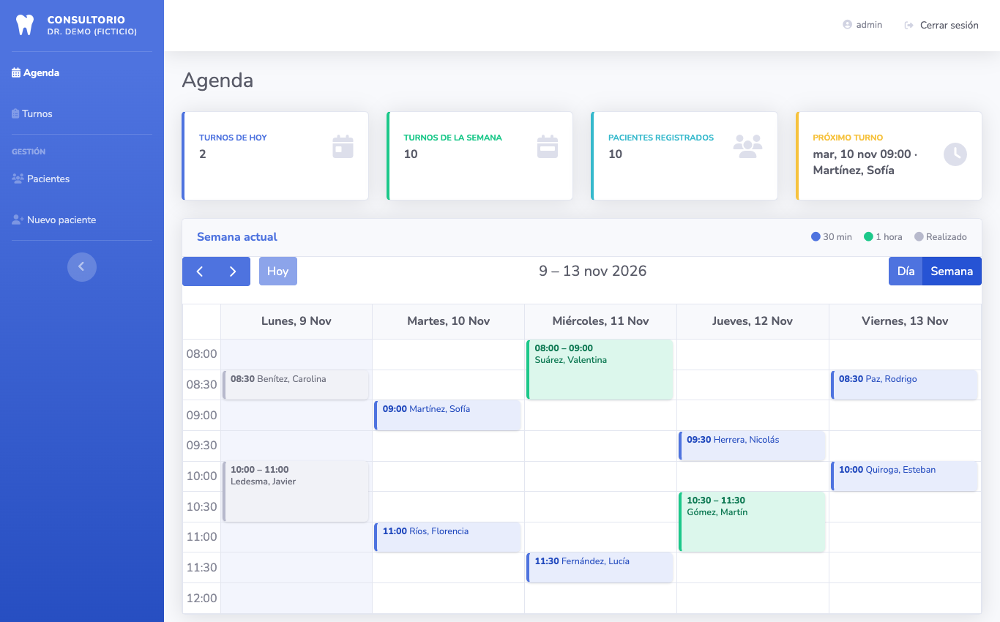
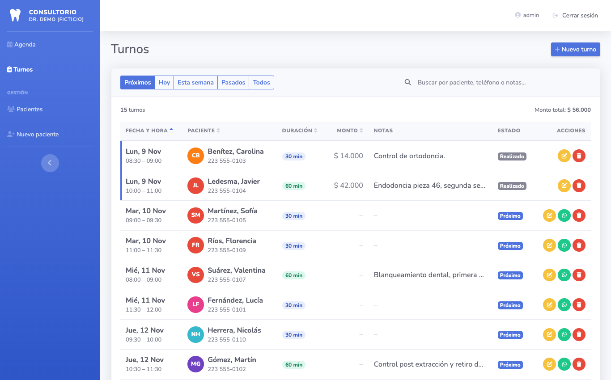
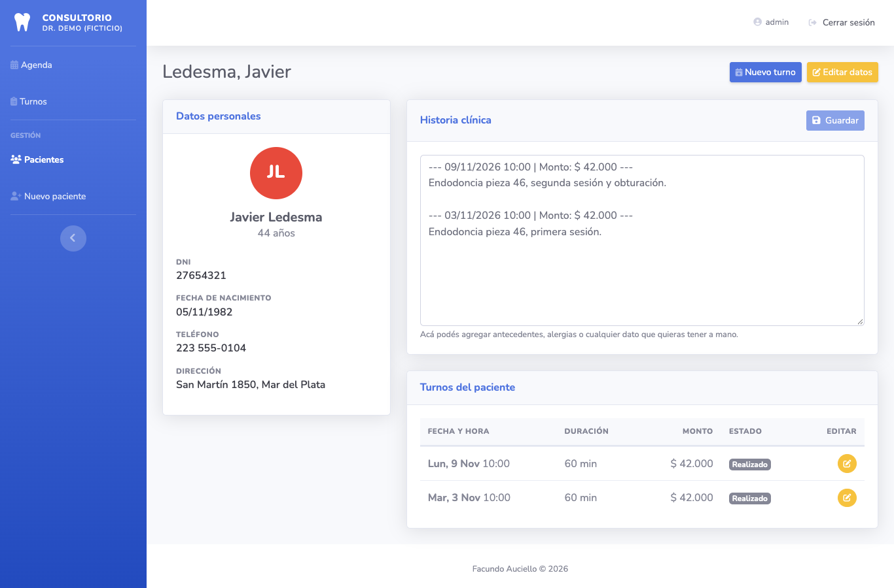
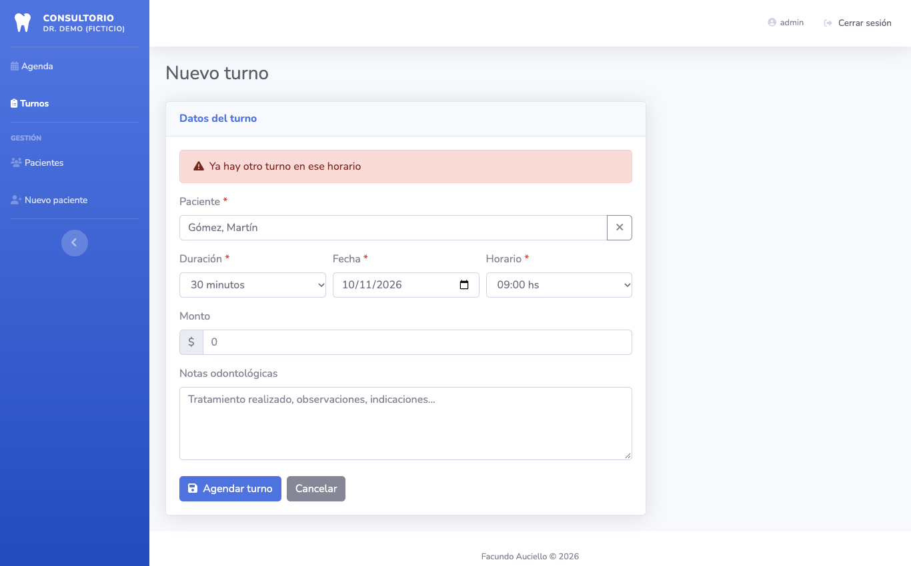
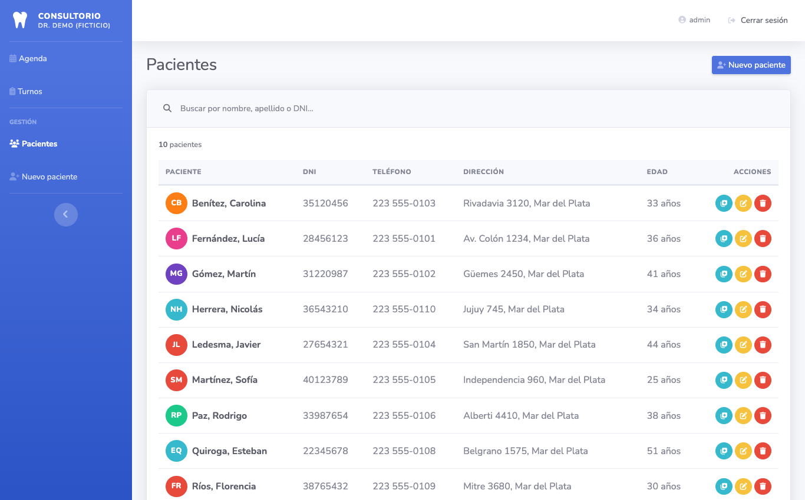
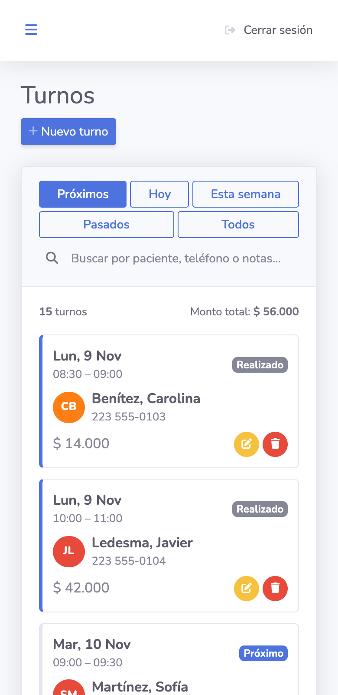
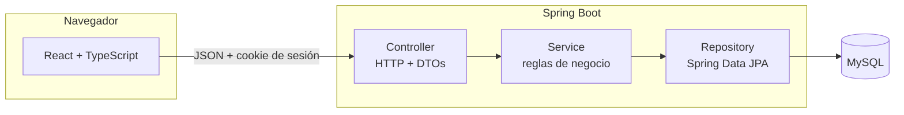
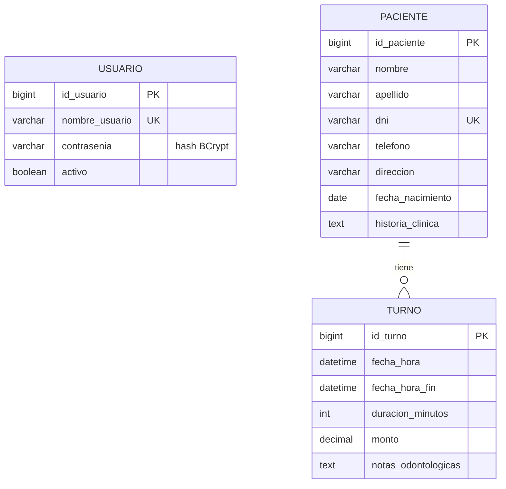

# 🦷 Consultorio Odontológico

Sistema de gestión para un consultorio odontológico: **agenda de turnos, pacientes e historia clínica**, con login y API REST.

Es el **primer proyecto que desarrollé para un cliente real** (me pagaron por él). La primera versión estaba hecha con JSP, Servlets y JPA puro; esta es la **reescritura completa** con un stack moderno: backend en **Spring Boot** y frontend en **React + TypeScript**.

> **Estado del proyecto:** el sistema se terminó y se entregó, y el cliente lo pagó, pero finalmente no lo puso en uso. Por eso no hay una instalación en producción: este repositorio trae un **modo demo con base H2 en memoria y datos ficticios** para probarlo sin instalar nada. La base pensada para producción es MySQL (ver "Opción 2 — Con MySQL" más abajo), pero los tests y la demo corren sobre H2.



## Capturas

| Turnos (tabla con filtros, orden y búsqueda) | Perfil del paciente con historia clínica |
|---|---|
|  |  |

| Alta de turno (validación de agenda en el servidor) | Pacientes |
|---|---|
|  |  |

<p align="center"></p>

> Los datos de las capturas y del modo demo son ficticios.

---

## Stack

| Capa | Tecnologías |
|---|---|
| **Backend** | Java 17 · Spring Boot 4 · Spring Web MVC · Spring Data JPA (Hibernate) · Bean Validation · Spring Security (BCrypt + sesión) · Lombok |
| **Base de datos** | MySQL (la base pensada para producción) · H2 en memoria (modo demo y tests) |
| **Frontend** | React 19 · TypeScript (modo estricto) · Vite · React Router · FullCalendar |
| **Estilos** | SB Admin 2 (Bootstrap 4) · FontAwesome — se mantuvo la estética de la versión original |
| **Tests** | JUnit 5 · Mockito · AssertJ (backend) · Vitest (frontend) |

## Funcionalidades

- **Login** con usuario y contraseña (guardada con **BCrypt**) y sesión de servidor. Pensado para un único usuario: la secretaria del consultorio.
- **Agenda semanal / diaria** con calendario: clic en un hueco para agendar, clic en un turno para editarlo. Colores por duración (30 min / 1 h) y turnos pasados atenuados.
- **Tabla de turnos** (rediseñada): filtros rápidos (próximos, hoy, semana, pasados, todos), búsqueda, columnas ordenables, paginación, estado calculado (*Próximo / Hoy / En curso / Realizado*), monto total y acciones por fila.
- **Recordatorio por WhatsApp** con el mensaje del turno ya escrito.
- **Pacientes**: alta, edición, baja (con confirmación, ya que borra también sus turnos) y búsqueda por nombre, apellido o DNI.
- **Historia clínica**: editable a mano y con entradas automáticas cada vez que un turno se guarda con notas o monto.
- **Reglas de agenda validadas en el servidor**: días laborales, horario de atención, duraciones permitidas, turnos alineados a la grilla y **sin superposición**.
- Panel con turnos de hoy, de la semana, pacientes registrados y próximo turno.
- Responsive: se usa desde el celular.

## Qué cambió respecto de la versión original

| Antes (JSP + Servlets) | Ahora |
|---|---|
| Contraseñas en texto plano en la base | Contraseña hasheada con BCrypt y sesión de servidor (cookie `HttpOnly`) |
| Páginas JSP renderizadas en el servidor | API REST + SPA en React/TypeScript |
| Entidades JPA usadas directamente | DTOs de entrada/salida + mappers |
| Fechas `java.util.Date`, duración y monto como `String` | `LocalDateTime`, minutos como `Integer`, dinero como `BigDecimal` |
| Se podían agendar dos turnos a la misma hora | Validación de superposición en el servidor |
| DNI repetido permitido | DNI único (validación + restricción en la base) |
| Se agregaba una entrada a la historia clínica en *cada* guardado | Solo cuando cambian las notas o el monto |
| Las reglas de horario vivían en el JavaScript del front | Viven en el backend (configurables) y el front las consulta |
| Listados que traían todo y filtraban en memoria | Consultas por rango de fechas y `@EntityGraph` (sin problema N+1) |
| Sin tests | Tests unitarios, de API de punta a punta, de repositorios y de concurrencia en el backend, y tests del cliente HTTP y las utilidades en el frontend |

---

## Arquitectura



**Backend** (`backend/src/main/java/com/consultorio`), organizado por capas:

```
controller/   Reciben la request HTTP y devuelven DTOs. Sin lógica de negocio
service/      Reglas de negocio y transacciones (@Transactional)
repository/   Interfaces Spring Data JPA
entity/       Usuario, Paciente, Turno
dto/          request/ (lo que entra, con validaciones) y response/ (lo que sale)
mapper/       Entidad <-> DTO
exception/    Excepciones de negocio + manejador global (@RestControllerAdvice)
security/     UserDetails para el login
config/       Seguridad (BCrypt + sesión), CORS, propiedades de agenda, datos de demo
utils/        HistoriaClinicaUtils
```

**Frontend** (`frontend/src`):

```
api/          Un cliente HTTP único + una función por endpoint
pages/        Una pantalla por ruta (Agenda, Turnos, Pacientes, formularios, perfil)
components/   layout/ (menú, barra), ui/ (tablas, diálogos...), forms/ (campos propios)
context/      Sesión (AuthContext) y avisos (AvisosContext)
hooks/        useConsulta (carga de datos), useDebounce
utils/        Fechas, formato, estado del turno, WhatsApp, validaciones (con tests)
types/        Tipos TypeScript que reflejan los DTOs del backend
```

### Modelo de datos



## API REST

Todas las rutas, salvo login y logout, exigen una sesión abierta (el navegador envía la cookie solo). Sin sesión responden `401`.
Los errores siempre tienen el mismo formato: `{ "status": 409, "error": "Conflict", "message": "..." }`.

| Método | Ruta | Descripción | Respuesta |
|---|---|---|---|
| `POST` | `/api/auth/login` | Inicia sesión (crea la sesión y la cookie) | 200 / 401 |
| `POST` | `/api/auth/logout` | Cierra la sesión | 204 |
| `GET` | `/api/auth/me` | Usuario de la sesión actual | 200 / 401 |
| `GET` | `/api/agenda/configuracion` | Horario, días y duraciones del consultorio | 200 |
| `GET` | `/api/agenda/resumen` | Números del panel principal | 200 |
| `GET` | `/api/pacientes?busqueda=` | Lista (o busca) pacientes | 200 |
| `POST` | `/api/pacientes` | Crea un paciente | 201 + `Location` |
| `GET` | `/api/pacientes/{id}` | Detalle con historia clínica | 200 / 404 |
| `PUT` | `/api/pacientes/{id}` | Edita los datos del paciente | 200 / 404 / 409 |
| `PATCH` | `/api/pacientes/{id}/historia-clinica` | Modifica solo la historia clínica | 200 |
| `DELETE` | `/api/pacientes/{id}` | Elimina al paciente y sus turnos | 204 |
| `GET` | `/api/pacientes/{id}/turnos` | Turnos de un paciente | 200 |
| `GET` | `/api/turnos?desde=&hasta=` | Turnos en un rango de fechas (opcional) | 200 |
| `GET` | `/api/turnos/hoy` | Turnos de hoy | 200 |
| `POST` | `/api/turnos` | Agenda un turno | 201 / 400 / 409 |
| `GET` | `/api/turnos/{id}` | Detalle de un turno | 200 / 404 |
| `PUT` | `/api/turnos/{id}` | Modifica un turno | 200 / 400 / 409 |
| `DELETE` | `/api/turnos/{id}` | Elimina un turno | 204 |

---

## Cómo correrlo

**Requisitos:** JDK 17 o superior y Node.js 20 o superior. Maven viene incluido (`mvnw`).

### Opción 1 — Modo demo (sin instalar nada más)

Usa una base H2 en memoria con pacientes y turnos de ejemplo.

```bash
# Terminal 1 — backend (http://localhost:8080)
cd backend
./mvnw spring-boot:run -Dspring-boot.run.profiles=demo

# Terminal 2 — frontend (http://localhost:5173)
cd frontend
npm install
npm run dev
```

Entrá a http://localhost:5173 con el usuario **`admin`** y la contraseña **`demo1234`**
(son públicas y solo existen en el perfil `demo`).

> En Windows usá `mvnw.cmd` en lugar de `./mvnw`.

### Opción 2 — Con MySQL

```bash
cp .env.example .env          # completá las claves (ver más abajo)
docker compose up -d          # levanta MySQL 8

cd backend
# cargá las variables del .env en tu terminal o en la configuración de tu IDE, y:
./mvnw spring-boot:run
```

### Variables de entorno del backend

| Variable | Obligatoria | Descripción |
|---|---|---|
| `DB_PASSWORD` | Sí | Contraseña de MySQL. Sin valor por defecto: si falta, la app no arranca |
| `DB_URL` / `DB_USER` | No | Por defecto MySQL local con usuario `root` |
| `ADMIN_USUARIO` / `ADMIN_CONTRASENIA` | Sí, la primera vez | Se crea ese usuario al arrancar (con la clave hasheada). Sin esto no hay con qué iniciar sesión |
| `CORS_ORIGEN` | No | Dominio del front permitido. Por defecto `http://localhost:5173` |
| `SESSION_COOKIE_SECURE` | No | Poner `true` en producción con HTTPS, para que la cookie viaje solo cifrada |

El **horario de atención** se cambia en `application.properties` (`consultorio.agenda.*`), sin tocar código: el back lo valida y el front lo lee de la API.
El **nombre del profesional** que aparece en el menú y en el mensaje de WhatsApp se configura en el front con `VITE_NOMBRE_PROFESIONAL` (ver `frontend/.env.example`).

### Tests

```bash
cd backend  && ./mvnw test        # JUnit + Mockito + MockMvc
cd frontend && npm test           # Vitest
cd frontend && npm run build      # chequeo de tipos + build de producción
```

Los tests del backend no necesitan MySQL ni variables de entorno: usan el perfil `demo` (H2 en memoria). Están en cuatro grupos:

| Grupo | Qué prueba |
|---|---|
| `service/` | La lógica de negocio con repositorios simulados (Mockito): reglas de la agenda, historia clínica, DNI. |
| `controller/` | La aplicación completa con pedidos HTTP simulados (MockMvc): login y sesión, códigos HTTP, formato del error, validaciones y reglas de agenda vistas desde el front. |
| `repository/` | Las consultas contra la base: detección de superposición de turnos en todos los casos, búsqueda de pacientes, DNI único. |
| `TurnoConcurrenciaTest` | Pedidos simultáneos para el mismo horario: tiene que quedar un solo turno. Si se le saca el cerrojo a `TurnoService`, el test falla. |

En el frontend, `utils/` (fechas, formato, validaciones, estado del turno, WhatsApp) y `api/cliente.test.ts` (errores, sesión vencida y parámetros del cliente HTTP).

### Producción

`npm run build` genera `frontend/dist`, archivos estáticos que se sirven desde cualquier hosting. La forma más simple es servir el front y la API bajo el **mismo dominio** (por ejemplo con un proxy inverso que reenvíe `/api` al backend), igual que hace el proxy de Vite en desarrollo. Si quedan en dominios distintos hay que configurar `VITE_API_URL`, `CORS_ORIGEN` y la cookie con `SameSite=None; Secure`.

---

## Decisiones de diseño

- **DTOs en vez de entidades en la API.** La API nunca expone la entidad: así la base puede cambiar sin romper el contrato, y no se filtran campos por accidente (la lista de pacientes ni siquiera envía la historia clínica, que puede ser larga).
- **Reglas en el backend, no en el front.** El front valida para dar respuesta inmediata, pero cualquiera puede llamar a la API sin pasar por la pantalla; la validación que cuenta es la del servidor.
- **Estado del turno calculado, no guardado.** *Realizado*, *En curso* o *Próximo* se deduce de la hora actual: nunca queda desactualizado ni requiere que alguien lo marque.
- **`open-in-view=false` y `@EntityGraph`.** Las consultas ocurren solo dentro de los services y los listados traen el paciente en un único `join`.
- **Sin secretos en el código.** La clave de la base y la del usuario inicial salen de variables de entorno, sin valores por defecto.
- **Sesión de servidor en vez de tokens.** La app la usa una sola persona, así que alcanza con una sesión común: el navegador guarda una cookie `HttpOnly` (JavaScript no puede leerla) con `SameSite=Lax`, que además evita pedidos falsos desde otros sitios.

## Posibles mejoras

- Migraciones con **Flyway** en lugar de `ddl-auto=update`.
- Límite de intentos de login (rate limiting) y tokens CSRF si algún día se sirve desde varios dominios.
- Paginación del lado del servidor cuando la cantidad de turnos y pacientes crezca mucho.
- Recordatorios automáticos (hoy el recordatorio se envía a mano con un clic).
- Roles (secretaria / odontólogo) y bloqueo de feriados o vacaciones en la agenda.
- Tests de integración con Testcontainers y pruebas end-to-end del front.

## Créditos y licencia

Código bajo licencia [MIT](LICENSE). La plantilla visual es [SB Admin 2](https://startbootstrap.com/theme/sb-admin-2) (MIT) y los íconos son de [FontAwesome Free](https://fontawesome.com).

Desarrollado por **Facundo Auciello**.
